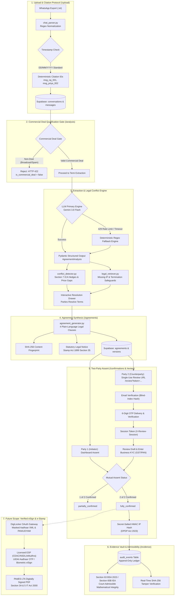

# DealShield AI — Working of the Project & Architecture Guide

For the full detailed documentation with API mappings, database schemas, and statutory frameworks, see **[`docs/how-it-works.md`](docs/how-it-works.md)**.

---

## ⚡ End-to-End System Workflow Diagram

DealShield AI converts informal WhatsApp commercial negotiations into structured, verifiable agreements across sequential, gate-verified stages:

---

## ⚡ Summary of the 5 Core Stages

### 1. Upload & Ingestion (`/upload`)
* Parses exported WhatsApp `.txt` transcripts (enforcing a 10MB limit).
* Resolves timestamp ambiguity using Indian `DD/MM/YYYY` standards.
* Assigns **verbatim citation IDs** (`msg_raj_001`, `msg_priya_004`) to every line for downstream legal citation.

### 2. Commercial Qualification & Section 7 Intelligence (`/analysis`)
* **Commercial Deal Qualification Gate:** Verifies multi-party participation ($\ge 2$ senders), deliverable scope keywords, and bilateral consideration before parsing terms. Rejects non-commercial announcements or banter with `HTTP 422`.
* **AI Extraction with Fallback:** Uses Google Gemini 3.8 Flash (`gemini-3.8-flash`) with Pydantic structured output validation ([`AgreementAnalysis`](apps/api/app/schemas/analysis.py)). If rate-limited (`429`), automatically retries with exponential backoff before falling back to the deterministic regex engine.
* **Section 7 Conflict Detector:** Enforces Section 7 of the Indian Contract Act, 1872 (*"Acceptance must be absolute and unqualified"*). Flags hedged statements (e.g. *"Sure, that works I think"*, *"depends on timeline"*) and price disputes.
* **Legal Knowledge Retriever:** Flags missing statutory protections under the **Copyright Act, 1957** (IP assignment upon full payment) and **Section 73 ICA 1872** (cancellation remedies & 7-day termination notice).
* **Interactive Drawer:** Parties can select compromise terms to turn ambiguous proposals into unconditional agreements.

### 3. Plain-Language Agreement Synthesis (`/agreements`)
* Synthesizes 4 formal, plain-language legal clauses aligned with Indian commercial law: Scope, Consideration, Timeline, and IP/Jurisdiction.
* Links every clause back to the original conversation with clickable citation chips.
* Computes an immutable **SHA-256 cryptographic digest** of the contract text.
* Displays statutory legal notice regarding stamp duty under the **Indian Stamp Act, 1899**.

### 4. Two-Party Mutual Confirmation & Review Session (`/confirmations` & `/review`)
* Requires mutual assent before activation:
  * **Party 1 (Initiator):** Assents directly via authenticated dashboard.
  * **Party 2 (Counterparty):** Accesses terms via single-use signed token URL (`/review?token=...`).
* **Email-OTP Security Gate:**
  * Draft terms remain locked behind an ephemeral `X-Review-Session` header.
  * Party 2 verifies registered email via blind-index hash match, receives a 6-digit cryptographic OTP, and enters optional business details (GST, PAN last 4, Address).
* **Database State Transitions:** `draft` → `partially_confirmed` → `fully_confirmed`.
* Anonymizes IP addresses using secret-salted HMAC for **DPDP Act 2023** compliance.

### 5. Section 65B / BSA Section 63 Evidence Vault (`/evidence`)
* Maintains an immutable, append-only audit trail (`audit_events` table).
* Allows any party or court to verify document integrity using real-time SHA-256 hashing.
* Provides mathematical proof of non-tampering admissible under **Section 65B of the Indian Evidence Act, 1872 / Section 63 of the Bharatiya Sakshya Adhiniyam, 2023**.

---

## 🔮 Future Implementation Scope

* **DigiLocker Identity Verification:** OAuth 2.0 gateway to verify Masked Aadhaar XML, PAN, and UDYAM certificates from official issuer repositories.
* **UIDAI Aadhaar eSign:** Integration with licensed eSign Service Providers (CDAC/NSDL/eMudhra) under Section 3A of the IT Act, 2000.
* **PAdES Digital PDF Sealing:** Embedded X.509 digital certificate signatures and RFC 3161 timestamps for offline verification.
* **Digital e-Stamping:** Automated state stamp duty computation and certificate attachment via NeSL / SHCIL.

---

## 📖 Complete Documentation Links

* [Complete System Workflow Guide](docs/how-it-works.md)
* [System Architecture](docs/architecture.md)
* [API Contracts & Payload Examples](docs/api-contracts.md)
* [Database Design & Schema](docs/database-design.md)
* [Security & DPDP Compliance](docs/security.md)
* [Hackathon Demonstration Plan](docs/demo-plan.md)
