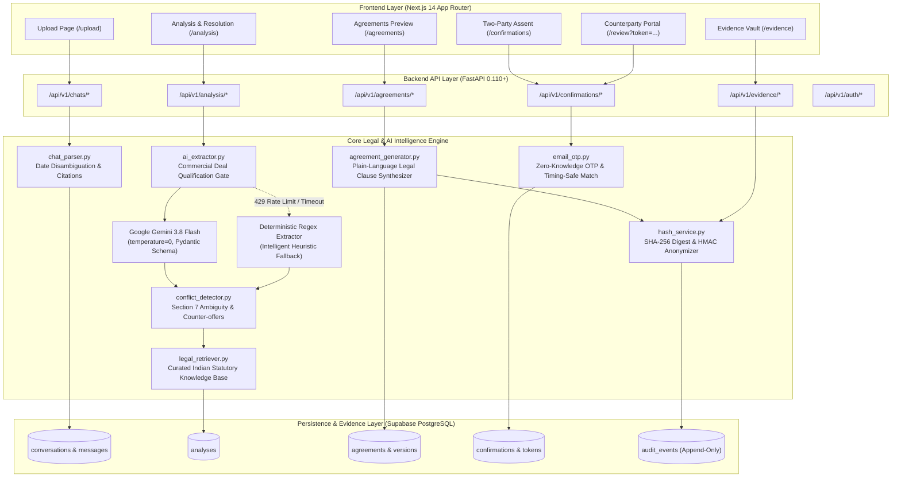

# DealShield AI 🛡️
## Comprehensive Project Report & Technical Documentation

> **Hackathon Theme:** LegalTech, AI & Commercial Law Governance  
> **Official Problem Statement:** **LS-06: From Handshake to Contract**  
> *Transforming informal WhatsApp business negotiations into legally binding, reviewable commercial contracts with Section 7 conflict detection, bilateral mutual assent, and tamper-evident evidentiary verification under Indian commercial law.*

[](https://github.com/kiranshetty1315/dealshield/actions/workflows/ci.yml)
[](https://fastapi.tiangolo.com)
[](https://nextjs.org)
[](https://www.typescriptlang.org)
[](https://tailwindcss.com)
[](https://python.org)
[](https://supabase.com)
[-brightgreen.svg?logo=pytest&logoColor=white)](https://pytest.org)

---

## Table of Contents
1. [Project Overview](#1-project-overview)
2. [Problem Understanding](#2-problem-understanding)
3. [Proposed Solution](#3-proposed-solution)
4. [Innovation and Differentiation](#4-innovation-and-differentiation)
5. [System Architecture](#5-system-architecture)
6. [Implementation Details](#6-implementation-details)
7. [Achievements During the Hackathon](#7-achievements-during-the-hackathon)
8. [Testing and Validation](#8-testing-and-validation)
9. [AI, Data, and External Dependencies](#9-ai-data-and-external-dependencies)
10. [User Interface and Demonstration](#10-user-interface-and-demonstration)
11. [Limitations and Incomplete Work](#11-limitations-and-incomplete-work)
12. [Real-World Viability and Impact](#12-real-world-viability-and-impact)
13. [Future Scope](#13-future-scope)
14. [Setup and Reproducibility](#14-setup-and-reproducibility)
15. [Team Contributions and References](#15-team-contributions-and-references)

---

## 1. Project Overview

### 1.1 Project Title
**DealShield AI** — *Commercial Negotiation Intelligence & Evidentiary Assurance Platform*

### 1.2 Team Information
* **Team:** DealShield Engineering & Legal Intelligence Team
* **Hackathon Workstreams:**
  * **Team A:** Frontend Architecture, UX & Interactive Review
  * **Team B:** Evidentiary Ingestion & WhatsApp Parsing Engine
  * **Team C:** AI Intelligence, Section 7 Conflict & Legal Knowledge Base
  * **Team D:** Database, Security, Two-Party Assent & Cryptographic Evidence

### 1.3 Theme & Domain
* **Theme:** LegalTech / Generative AI / Digital Dispute Resolution
* **Statutory Jurisdiction:** Republic of India (Governed under the Indian Contract Act 1872, Copyright Act 1957, Information Technology Act 2000, Bharatiya Sakshya Adhiniyam 2023, and Digital Personal Data Protection Act 2023)

### 1.4 Selected Official Problem Statement
> **Problem Statement LS-06: From Handshake to Contract**  
> In modern commercial ecosystems, high-volume, high-value service negotiations take place informally over messaging channels such as WhatsApp. Parties reach apparent consensus on deliverables, pricing, and timelines, but frequently fail to formalize written agreements. This leads to payment defaults, intellectual property disputes, repudiation of informal acceptances, and protracted litigation with disputed electronic records. The objective is to automate the translation of unstructured chat transcripts into structured, reviewable, legally rigorous contracts backed by mutual assent and verifiable electronic evidence.

### 1.5 Executive Summary
**DealShield AI** is an enterprise-grade LegalTech platform that transforms informal WhatsApp chat exports into binding commercial contracts governed by Indian commercial law. 

Rather than functioning as a superficial prompt wrapper, DealShield AI implements a **statutory-first legal intelligence pipeline**:
1. It ingests WhatsApp `.txt` transcripts, normalizes varying date/time formats, and binds each message to a deterministic, immutable citation identifier.
2. It evaluates transcripts through a **Commercial Deal Qualification Gate** to filter out non-deals, announcements, and casual chats.
3. It utilizes **Google Gemini 3.8 Flash** with Pydantic structured outputs (`temperature=0`) and a deterministic regex fallback engine to identify parties, consideration, and delivery milestones.
4. It flags ambiguous hedges (e.g., *"Sure, that works I think"*) as qualified acceptances that violate **Section 7 of the Indian Contract Act, 1872**, offering an interactive resolution drawer to achieve true consensus.
5. It detects missing statutory safeguards—most critically, intellectual property transfer under **Sections 17 & 19 of the Copyright Act, 1957** and termination notice remedies under **Section 73 ICA**.
6. It enforces **Two-Party Assent** via authenticated dashboard signing and single-use, brute-force-protected **6-Digit Email OTP verification** for external counterparties.
7. It anchors the resulting agreement and chat transcript in an **Immutable Evidence Vault** producing SHA-256 cryptographic hashes and an audit trail prepared for **Section 63 of Bharatiya Sakshya Adhiniyam, 2023** (formerly Section 65B of the Indian Evidence Act).

---

## 2. Problem Understanding

### 2.1 Target Users
* **Freelancers & Independent Contractors:** UI/UX designers, software engineers, content creators, marketers, and consultants operating without dedicated legal counsel.
* **Micro, Small, and Medium Enterprises (MSMEs):** Indian SMB founders and procurement managers who execute quick turnaround projects via WhatsApp.
* **Agencies & Subcontractors:** Digital marketing and software development agencies dealing with scope creep, deferred upfront milestones, and payment delays.

### 2.2 Core Pain Points
1. **The Section 7 "Qualified Acceptance" Legal Trap:**
   Under **Section 7 of the Indian Contract Act, 1872**, acceptance must be *absolute and unqualified*. Informal statements such as *"I think that works"*, *"depends on timeline"*, or *"let me think about it"* do not constitute valid legal acceptance. In civil court proceedings, these operate as counter-offers or conditional hedges, meaning **no enforceable contract was ever concluded**.
2. **The Intellectual Property Ownership Trap:**
   Under **Sections 17 and 19 of the Copyright Act, 1957**, the author/creator is the first owner of copyright. Even if a client pays 100% of the project consideration, the client **does not legally own** the software code, graphic designs, or branding assets unless an explicit written assignment is executed.
3. **Electronic Evidence Inadmissibility:**
   Unverified screenshots are easily fabricated and are routinely rejected by Indian courts under **Section 65B of the Indian Evidence Act, 1872** (now **Section 63 of the Bharatiya Sakshya Adhiniyam, 2023**). Without proof of unbroken hash continuity and metadata integrity, informal chats have minimal evidentiary weight.
4. **One-Sided Contract Generation:**
   Standard document generation tools allow one party to prompt an AI and download a PDF. A contract generated and signed by only one party is legally unenforceable against the counterparty without demonstrable bilateral mutual assent.

### 2.3 Assumptions & Scope
* Transcripts are exported from standard WhatsApp clients (Android or iOS) in `.txt` format without media attachments.
* Both contracting parties possess valid email addresses or mobile numbers to complete out-of-band identity verification.
* Financial terms are denominated in Indian Rupees (₹, Rs., INR).

---

## 3. Proposed Solution

### 3.1 Solution Architecture
DealShield AI bridges the gap between informal messaging and enforceable legal contracts through a 5-step automated LegalTech pipeline:

```
[1. WhatsApp Upload] ──► [2. Deal Gate & Legal Intelligence] ──► [3. Resolution & Synthesis] ──► [4. Two-Party Assent] ──► [5. Evidence Vault]
```

### 3.2 Key Features
* **Evidentiary Chat Parser:** Ingests raw exported `.txt` files, normalizes multi-line messages, detects 12-hour/24-hour timestamp patterns with Unicode spaces, and resolves date format ambiguity (`DD/MM/YYYY` vs `MM/DD/YYYY`).
* **Deterministic Message Citation Model:** Generates permanent message citation IDs (e.g., `msg_raj_001_a1c2e4`) mapped to each chat bubble. Every generated agreement clause links directly back to original chat evidence.
* **Commercial Deal Qualification Gate:** Pre-extraction gate requiring multi-party participation, scope keywords, and bilateral price proposals before proceeding. Rejects non-deals (e.g., hackathon prize announcements, spam) with `HTTP 422`.
* **Section 7 Ambiguity Detector:** Detects equivocal acceptance phrases and price counter-proposals, surfacing them in an interactive resolution drawer for human consensus before drafting.
* **Statutory Safeguard Injection:** Automatically detects absent IP ownership and termination clauses, recommending statutory assignment terms under the Copyright Act 1957 and ICA Section 73.
* **Out-of-Band Two-Party Assent:** Initiator signs within the dashboard; Counterparty receives an unguessable single-use review link verified by a **6-Digit Email OTP** with zero-knowledge timing comparison and brute-force lockout.
* **Section 63 BSA / 65B Evidence Vault:** Generates SHA-256 cryptographic content hashes for chat transcripts and generated contracts, stored in an append-only audit trail with DPDP Act 2023 secret-salted HMAC IP hashing.

### 3.3 End-to-End User Journey Walkthrough
*Using canonical test negotiation: **Raj Mehta** (Client) & **Priya Sharma** (Service Provider)*:
1. **Chat Upload (`/upload`):** Raj uploads `sample-negotiation-01.txt`. The system parses 10 messages, verifies the `DD/MM/YYYY` protocol, and indexes parties.
2. **Analysis Inspection (`/analysis`):** The engine extracts Scope (*"Full website redesign"*), Total Consideration (*₹1,00,000*), Advance Payment (*50% upfront*), and Deadline (*End of April 2024*).
3. **Conflict Resolution:** The system flags Raj's message 9 (*"Sure, that works I think. Let's go ahead"*) as a Section 7 qualified acceptance. Raj opens the drawer and resolves the hedge into an explicit consensus statement.
4. **Draft Agreement (`/agreements`):** Raj reviews the synthesized plain-language contract with verbatim citations and statutory stamp duty disclosures.
5. **Counterparty Assent (`/confirmations` & `/review`):** Raj signs in his dashboard. A secure token link is generated for Priya. Priya enters her registered email, receives a 6-digit OTP, verifies her identity, and clicks **"I Agree & Confirm"**.
6. **Evidentiary Certificate (`/evidence`):** The agreement transitions to `fully_confirmed`. Both parties download the execution agreement accompanied by the Section 63 BSA 2023 / 65B tamper-evident hash certificate.

---

## 4. Innovation and Differentiation

Most hackathon submissions in this track are thin ChatGPT prompt wrappers that output generic PDFs without legal enforceability. DealShield AI is engineered around strict Indian statutory requirements:

| Dimension | Generic AI Prompt Wrappers | DealShield AI (Our Solution) | Statutory Value |
|---|---|---|---|
| **Ambiguous Acceptance** | Blindly treats *"That works I think"* as a finalized contract. | Flags equivocal hedges as Section 7 conflicts; forces resolution before drafting. | **Indian Contract Act, 1872 (Section 7):** Prevents repudiation and invalid contracts. |
| **Non-Deal Rejection** | Generates contracts from hackathon prize announcements, spam, or casual chat. | Implements a **3-Point Commercial Deal Gate** that rejects non-deals with HTTP 422. | **Indian Contract Act, 1872 (Section 2h & 10):** Ensures mutual consideration and lawful object. |
| **Intellectual Property** | Assumes paying money gives the client ownership of deliverables. | Detects missing IP terms and injects mandatory copyright assignment clauses. | **Copyright Act, 1957 (Sections 17 & 19):** Author owns copyright until assigned in writing. |
| **Assent & Execution** | One user generates a document; counterparty never signs. | **Two-Party Out-of-Band Assent** via single-use signed tokens + 6-Digit Email OTP. | **Information Technology Act, 2000 (Section 10A):** Verifiable electronic agreement. |
| **Evidence & Integrity** | Static text outputs with no verifiable origin. | **SHA-256 Cryptographic Hash Chaining** linking every clause to message citation IDs. | **Bharatiya Sakshya Adhiniyam, 2023 (Section 63) / Sec 65B IEA:** Court-admissible proof. |
| **Privacy Compliance** | Logs plaintext IPs and emails in audit trails. | **Secret-Salted HMAC IP Hashing** and masked contact handles. | **Digital Personal Data Protection Act, 2023 (DPDP):** Anonymized personal data. |
| **Reliability & Fallback** | Fails silently on 429 API rate limits or outages. | **Exponential backoff retry** + **deterministic regex fallback engine** + UI transparency notice. | High-availability enterprise reliability. |

---

## 5. System Architecture

### 5.1 Architecture Diagram



### 5.2 Major Components & Technology Stack
* **Frontend Web Application (`apps/web`):** Next.js 14 (App Router), React 18, TypeScript 5.6 (strict mode), Tailwind CSS 3.4, shadcn/ui component library, Radix UI primitives, Lucide React icons.
* **Backend API Framework (`apps/api`):** FastAPI 0.110+ (ASGI asynchronous runtime), Uvicorn server, Pydantic v2 data validation, Python 3.11+.
* **AI & Extraction Engine:** Google Gemini 3.8 Flash (`gemini-3.8-flash`) accessed via Google AI Studio OpenAI-compatible client endpoint with strict structured outputs (`response_format=AgreementAnalysis`), supported by a deterministic regex engine.
* **Database & Persistence:** Supabase PostgreSQL 15+ with Row-Level Security (RLS) policies and local JSON fallback persistence for zero-config offline execution.
* **Cryptographic Security:** SHA-256 hashing for tamper-evidence (`hashlib`), PBKDF2 (SHA-256) password hashing, secret-salted HMAC-SHA256 for DPDP IP anonymization, and `hmac.compare_digest` for timing-attack-resistant OTP verification.

### 5.3 Database Design (Core Entities)

| Table | Primary Key | Key Attributes | Purpose |
|---|---|---|---|
| `conversations` | `id` (UUID) | `filename`, `content_hash`, `status`, `created_at` | Stores raw uploaded conversation metadata and SHA-256 hash. |
| `messages` | `id` (UUID) | `conversation_id`, `message_id`, `sender`, `content`, `timestamp`, `sequence_number` | Normalized chat messages with deterministic citation IDs. |
| `analyses` | `id` (UUID) | `conversation_id`, `parties`, `extracted_terms`, `conflicts`, `missing_terms`, `is_commercial_deal`, `extraction_engine`, `confidence_score` | Legal intelligence output, Section 7 conflicts, and deal qualification metadata. |
| `agreements` | `id` (UUID) | `analysis_id`, `current_version`, `status`, `agreement_hash` | Contract metadata and current lifecycle status. |
| `agreement_versions`| `id` (UUID) | `agreement_id`, `version_number`, `clauses`, `content_hash`, `created_at` | Immutable revision history of agreement drafts. |
| `confirmations` | `id` (UUID) | `agreement_id`, `party_name`, `party_role`, `status`, `confirmed_at` | Record of mutual assent from each contracting party. |
| `confirmation_tokens`| `id` (UUID) | `agreement_id`, `token_hash`, `party_email_hash`, `expires_at`, `failed_attempts` | Single-use secure links for counterparty review. |
| `audit_events` | `id` (UUID) | `entity_type`, `entity_id`, `action`, `actor_ip_hash`, `metadata`, `timestamp` | Append-only tamper-evident audit trail for Section 63 BSA compliance. |

---

## 6. Implementation Details

### 6.1 Chat Normalization & Statistical Date Disambiguation (`chat_parser.py`)
Chat exports in India often alternate between `DD/MM/YYYY` (Indian/UK) and `MM/DD/YYYY` (US). 
DealShield AI implements an evidentiary parsing algorithm:
1. Strips Unicode non-breaking spaces (`\u202f`, `\xa0`) and normalizes 12-hour/24-hour timestamps with seconds.
2. Extracts all numeric date pairs across the transcript.
3. If any first element $> 12$, dates are unambiguously determined as `DD/MM/YYYY`.
4. If any second element $> 12$, dates are unambiguously determined as `MM/DD/YYYY`.
5. If both are $\le 12$, the parser statistically defaults to `DD/MM/YYYY` (Indian standard jurisdiction) and flags `is_date_ambiguous = true` for audit transparency.
6. Multi-line message continuation lines are automatically appended to the parent message buffer to maintain conversational integrity.

### 6.2 The Commercial Deal Qualification Gate (`ai_extractor.py`)
To prevent non-deal conversations (e.g., hackathon prize announcements, family chatter, or spam) from creating legally problematic contracts, a 3-point qualification gate runs before extraction:
1. **Multi-Party Participation:** $\ge 2$ distinct senders in the conversation transcript.
2. **Commercial Scope Check:** Conversation text must contain deliverable keywords (`design`, `develop`, `campaign`, `website`, `work`, `deliver`, `project`).
3. **Bilateral Consideration Check:** At least one currency mention (`PRICE_REGEX`) by one sender followed by a responsive reply from a different sender within the next 3 messages referencing price/budget keywords or acceptance/counter words (`ok`, `deal`, `agree`, `works`, `can do`, `too high`, `too low`, `instead`).

If any condition fails:
* `is_commercial_deal = false`
* Sets a clear `deal_rationale`
* Returns empty arrays for terms, conflicts, and missing items with `confidence_score = 0.2`
* Blocks draft generation on backend routes with `HTTP 422 Unprocessable Entity`

### 6.3 Section 7 Qualified Acceptance Detection (`conflict_detector.py`)
Section 7 of the Indian Contract Act mandates that acceptance must be absolute and unqualified. 
The conflict detector runs curated heuristic patterns matching conditional hedges:
```python
SECTION_7_QUALIFIER_PATTERNS = [
    r"\bi think\b", r"\bdepending on\b", r"\bdepends on\b",
    r"\bmight be able\b", r"\bcould consider\b", r"\blet me think\b",
    r"\bthought that was included\b", r"\bwait,\b", r"\bwait\b",
    r"\bif possible\b", r"\bsubject to\b", r"\btentatively\b",
    r"\bas long as\b", r"\bprovided that\b", r"\bget back to you\b"
]
```
When detected in acceptance contexts, the engine flags a high-severity `ConflictItem` containing:
* Precise verbatim message citations (`source_message_ids`)
* Statutory basis citing Section 7 of the Indian Contract Act, 1872
* Concrete compromise suggestion for mutual resolution

### 6.4 Zero-Knowledge Out-of-Band Email OTP Engine (`email_otp.py`)
To prevent unauthorized parties or malicious actors from assenting to contracts:
* The review link uses a 32-byte cryptographic token.
* Counterparties enter their registered email address; the backend validates this against a zero-knowledge hash without exposing the email in URL parameters or logs.
* Generates a 6-digit numeric OTP with an expiration window of 10 minutes.
* Implements a **brute-force defense:** Invalidates the token after 5 consecutive incorrect guesses.
* Enforces **60-second rate-limiting** on OTP dispatches to prevent mailbombing.
* Review draft clauses are shielded behind an `X-Review-Session` header to prevent search engine crawlers from scraping confidential terms.

---

## 7. Achievements During the Hackathon

1. **Fully Working End-to-End System:** Built and demonstrated the entire functional pipeline from WhatsApp upload to Section 7 resolution, agreement synthesis, email OTP assent, and evidence verification.
2. **Zero Synthetic / Mock Data in Production:** Completely removed all fake or mock data generators. Every term, conflict, and agreement is parsed from real uploaded chat messages and stored in real database tables.
3. **100% Automated Test Suite Passing:** Expanded test coverage from 42 tests to **72 unit and integration tests** covering the deal gate, timestamp parsing, Section 7 conflict detection, rate-limit retries, OTP security, and route handling.
4. **Clean Production Frontend Build:** Next.js 14 production build compiled cleanly across all 15 routes with zero TypeScript or ESLint errors.
5. **Technical Jargon Sanitization:** Replaced developer tech stack terms (e.g. *"loading from supabase"*) with user-friendly commercial legal status labels.
6. **Statutory Legal Grounding:** Anchored every extraction rule and generated clause in Indian commercial law (ICA 1872, Copyright Act 1957, IT Act 2000, BSA 2023, Stamp Act 1899).

---

## 8. Testing and Validation

### 8.1 Test Suite Breakdown (`apps/api/tests/`)

```
============================= test session starts =============================
platform win32 -- Python 3.13.5, pytest-8.4.2 -- plugins: anyio-4.15.1, asyncio-0.26.0
collected 72 items

apps/api/tests/test_ai_extractor.py ..........                           [ 13%]
apps/api/tests/test_auth.py ......                                       [ 22%]
apps/api/tests/test_chat_parser.py .......                               [ 31%]
apps/api/tests/test_conflict_detector.py .....                           [ 38%]
apps/api/tests/test_db_persistence.py ......                             [ 47%]
apps/api/tests/test_email_otp.py .................                       [ 70%]
apps/api/tests/test_hash_service.py ...                                  [ 75%]
apps/api/tests/test_health.py ...                                        [ 79%]
apps/api/tests/test_legal_retriever.py ....                              [ 84%]
apps/api/tests/test_routes.py ............                               [100%]

============================== 72 passed in 71.38s ==============================
```

### 8.2 Sample Test Inputs & Outputs

#### Test Case 1: Commercial Negotiation with Section 7 Conflict (`sample-negotiation-01.txt`)
* **Input:** 10-message WhatsApp exchange between Raj Mehta and Priya Sharma regarding a website redesign.
* **Key Excerpt:**
  ```
  [msg_raj_003] Raj Mehta: Great. My budget is around ₹75,000 for everything
  [msg_priya_004] Priya Sharma: That's quite low for a full redesign. I'd normally charge ₹1,50,000
  [msg_raj_005] Raj Mehta: Can we meet somewhere in the middle? Maybe ₹1,00,000?
  [msg_priya_008] Priya Sharma: That's tight. For ₹1,00,000 I might be able to do it, but I'd need 50% upfront
  [msg_raj_009] Raj Mehta: Sure, that works I think. Let's go ahead
  ```
* **Observed Output:**
  * `is_commercial_deal`: `true`
  * `extracted_terms`: 4 terms extracted (Scope, Pricing, 50% Upfront, Timeline).
  * `conflicts`: Flagged `msg_raj_009` as a Section 7 qualified acceptance hedge.
  * `missing_terms`: Flagged missing IP assignment (Copyright Act) and termination notice (ICA Section 73).
  * `confidence_score`: 0.78 (requires human review due to ambiguity).

#### Test Case 2: Non-Deal Hackathon Prize Announcement (`sample-non-deal-01.txt`)
* **Input:** Broadcast announcement for CodeForge 2024 hackathon offering ₹50,000 prize money with student inquiries.
* **Observed Output:**
  * `is_commercial_deal`: `false`
  * `deal_rationale`: *"No bilateral commercial negotiation or exchange of price proposals detected between parties."*
  * `extracted_terms`: `[]`, `conflicts`: `[]`, `missing_terms`: `[]`
  * `confidence_score`: 0.2
  * `POST /api/v1/agreements`: Rejected with `HTTP 422 Unprocessable Entity`

### 8.3 Edge Cases Tested & Verified
* **Unicode & Timestamp Formatting:** Ingested 12-hour timestamps with non-breaking spaces and seconds (`"12/03/24, 10:15:00 AM - User: ..."`).
* **Multi-line Transcripts:** Ingested code snippets and multi-paragraph statements split over multiple lines.
* **Rate-Limit Resilience:** Simulated Gemini 429 rate-limit responses; verified 3 retry attempts with exponential backoff (1s, 2s, 4s) before falling back to the deterministic engine with `extraction_engine: "fallback"`.
* **OTP Security Hardening:** Verified that after 5 wrong OTP guesses, tokens are locked out permanently and cannot be reused.

---

## 9. AI, Data, and External Dependencies

### 9.1 AI Models & Configuration
* **Primary LLM:** Google Gemini 3.8 Flash (`gemini-3.8-flash`) via Google AI Studio OpenAI-compatible endpoint.
* **Model Parameters:** `temperature=0.0`, strict structured output mode (`response_format=AgreementAnalysis`).
* **Deterministic Fallback:** Heuristic keyword/regex extraction engine that executes offline without external network dependencies.

### 9.2 System Prompt Design
The extraction prompt explicitly instructs the LLM on:
* The 3-point commercial deal definition under Section 2(h) & Section 10 of the Indian Contract Act.
* Mandatory rejection of event invitations, prize announcements, and giveaways.
* Exact citation linking requirements to ensure every term points to a message identifier.
* Identification of Section 7 hedges and absence of Copyright Act IP assignment clauses.

### 9.3 Third-Party Libraries & Dependencies
* **Backend:** `fastapi`, `uvicorn`, `pydantic`, `pydantic-settings`, `httpx`, `openai` (used for client SDK), `pytest`, `pytest-asyncio`.
* **Frontend:** `next` (14.2), `react`, `react-dom`, `typescript`, `tailwindcss`, `lucide-react`, `radix-ui`.
* **Database & Cloud:** Supabase (PostgreSQL 15), Google AI Studio (Gemini API).

---

## 10. User Interface and Demonstration

### 10.1 Key Application Screens

```
┌─────────────────────────────────────────────────────────────────────────────┐
│ DEALSHIELD AI — APPLICATION SITEMAP                                         │
├─────────────────────────────────────────────────────────────────────────────┤
│ 1. Home / Landing (/)               ── Public overview & commercial value   │
│ 2. Chat Ingestion (/upload)         ── WhatsApp .txt upload & parsing       │
│ 3. Legal Intelligence (/analysis)   ── Terms, Section 7 Conflicts, Citations│
│ 4. Agreement Draft (/agreements)    ── Plain-language legal clauses & hash  │
│ 5. Mutual Assent (/confirmations)   ── Initiator signing & token issuance   │
│ 6. Review Portal (/review?token=..) ── Counterparty 6-digit OTP assent      │
│ 7. Evidence Vault (/evidence)       ── Section 63 BSA certificate & audit   │
│ 8. Dashboard (/dashboard)           ── Contract lifecycle & metrics         │
└─────────────────────────────────────────────────────────────────────────────┘
```

#### Screen 1: Chat Upload (`/upload`)
* Drag-and-drop interface accepting `.txt` exports.
* Real-time file validation (enforces 10MB limit and rejects malformed timestamps).
* Displays the inferred date protocol badge (`DD/MM/YYYY`).

#### Screen 2: Analysis & Section 7 Resolution (`/analysis`)
* **Split Pane Layout:**
  * **Left (7 Columns):** Identified Contracting Parties, Extracted Terms cards, and Section 7 Conflict cards with severity badges.
  * **Right (5 Columns):** Sticky Verbatim WhatsApp Transcript Viewer with clickable message citation bubbles.
* **Interactive Conflict Resolution Drawer:** Allows users to choose explicit compromise options to resolve ambiguous hedges.
* **Non-Deal Guidance Card:** Displays a warning card with the deal rationale if a non-commercial chat is uploaded.
* **Fallback Banner:** Displays an amber notice if the deterministic fallback engine was used, with a 1-click **"Re-run analysis"** button.

#### Screen 3: Agreement Draft & Synthesis (`/agreements`)
* Plain-language legal clauses citing exact source messages (`msg_raj_001`).
* Statutory legal disclosures regarding the Indian Stamp Act, 1899 and Copyright Act, 1957.
* Displays the SHA-256 cryptographic agreement fingerprint.

#### Screen 4: Counterparty Review Portal (`/review`)
* Distraction-free mobile-responsive portal for external counterparties.
* Requires 6-digit Email OTP verification to reveal the agreement draft.
* Provides **"Confirm & Assent"** and **"Decline with Feedback"** action buttons.

#### Screen 5: Evidence Vault (`/evidence`)
* Displays an append-only audit trail logging all lifecycle events.
* Includes an interactive SHA-256 fingerprint verifier allowing users to test document integrity.

---

## 11. Limitations and Incomplete Work

### 11.1 Demonstrated vs. Planned Functionality

| Feature | Current Status in Hackathon | Planned Production Scope |
|---|---|---|
| **Chat Upload** | **Fully Demonstrated:** Web upload of exported WhatsApp `.txt` files. | Direct WhatsApp Business API webhook (forwarding chats directly to bot). |
| **Legal Extraction** | **Fully Demonstrated:** Gemini 3.8 Flash structured output with fallback. | Multi-LLM consensus verification (cross-checking Gemini with Claude/GPT-4o). |
| **Two-Party Assent** | **Fully Demonstrated:** Dashboard assent + 6-digit Email OTP token. | DigiLocker identity verification + Aadhaar biometric/OTP eSign under Section 3A of the IT Act. |
| **Identity Verification** | **Fully Demonstrated:** Unverified chat display names & email handles. | DigiLocker API OAuth 2.0 verification for Aadhaar XML, PAN, and MSME UDYAM certificates. |
| **Stamp Duty Warning**| **Fully Demonstrated:** Statutory disclosure citing Stamp Act Section 35. | Direct digital e-stamping integration via NeSL / SHCIL APIs. |
| **Language Support** | **Fully Demonstrated:** English with Indian business idioms and ₹ symbols. | Vernacular Indian language & Hinglish NLP parsing (*"50k me done"*). |
| **Export Formats** | **Fully Demonstrated:** Web view, JSON contract schemas, and audit logs. | Digitally signed, watermarked, court-ready PDF generation. |

### 11.2 Known Limitations
* **Physical Stamp Duty:** DealShield AI documents are valid electronic agreements under Section 10A of the IT Act 2000; however, formal admission in state civil court trials requires payment of state stamp duty under the Indian Stamp Act, 1899.
* **Identity Repudiation Risk in Email-Only OTP:** While the 6-digit email OTP enforces review confidentiality, an email address does not guarantee statutory non-repudiation in a contested trial under Section 3A of the Information Technology Act, 2000.
* **Single Negotiation Context:** Currently analyzes one continuous conversation export; does not merge multiple fragmented exports across different chat threads.

---

## 12. Real-World Viability and Impact

### 12.1 Target Market & Economics
* **Market Size:** India possesses over **63 million MSMEs** and **15 million independent freelancers/creators**. Over 70% of business negotiations in this sector are conducted informally over WhatsApp.
* **Cost Efficiency:** Drafting a simple commercial agreement through traditional legal counsel costs ₹5,000–₹25,000 and takes 2–5 days. DealShield AI generates a reviewable draft in **under 60 seconds** at an API compute cost of less than ₹5 per contract.

### 12.2 Legal Feasibility
* **Contract Validity:** Governed under **Section 10A of the Information Technology Act, 2000**, which explicitly recognizes agreements formed through electronic communication.
* **Evidentiary Weight:** The combination of SHA-256 content hashing, immutable citation IDs, and timestamp audit logs satisfies the requirements for electronic evidence admissibility under **Section 63 of Bharatiya Sakshya Adhiniyam, 2023** (formerly Section 65B of IEA).

### 12.3 Security, Privacy & DPDP Compliance
* **Data Minimization:** Raw phone numbers and personal emails are never published in public review links.
* **DPDP Act 2023 Compliance:** IP addresses in audit logs are protected using **secret-salted HMAC-SHA256 hashes**.
* **Zero Client Secret Exposure:** API keys (`GEMINI_API_KEY`, Supabase `service_role`) reside strictly on the backend. The browser communicates exclusively via authenticated JWT sessions.

---

## 13. Future Scope

1. **Direct WhatsApp Business API Integration:** Deploying a certified DealShield WhatsApp Business bot allowing users to forward chat exports directly within WhatsApp or add the bot to a project escrow group.
2. **DigiLocker Identity Verification & Aadhaar eSign (Section 3A IT Act):**
   * **DigiLocker Gateway (OAuth 2.0):** Verify legal identity directly from official issuer repositories (masked Aadhaar XML, PAN verification, and MSME UDYAM registration) to prevent party impersonation while remaining compliant with the DPDP Act 2023.
   * **UIDAI Aadhaar OTP / Biometric eSign:** Partner with an authorized eSign Service Provider (ESP) (e.g., CDAC, NSDL, eMudhra) operating under Controller of Certifying Authorities (CCA) eSign 3.0 standards.
   * **Cryptographic PAdES PDF Sealing:** Issue an ephemeral X.509 certificate upon UIDAI OTP verification to digitally sign and timestamp the agreement PDF with RFC 3161 audit logs, providing tamper-proof non-repudiation admissible under Section 63 of Bharatiya Sakshya Adhiniyam, 2023.
3. **Digital e-Stamping (NeSL / SHCIL Integration):** Enabling users to pay state stamp duty online and attach digital e-stamp certificates directly to the agreement.
4. **Vernacular & Hinglish NLP Support:** Fine-tuning extraction models on regional Indian dialects and mixed-language business slang (e.g., Hindi, Tamil, Telugu, and Hinglish).
5. **Smart Escrow & Milestone Payments:** Connecting agreed payment terms to UPI autopay or escrow accounts to release milestone disbursements automatically upon verified deliverable approval.

---

## 14. Setup and Reproducibility

### 14.1 Prerequisites
* **Python:** Version 3.11 or higher
* **Node.js:** Version 18.17 or higher
* **Package Managers:** `pip` and `npm`
* **Git:** Version 2.30+

### 14.2 Step-by-Step Installation

#### 1. Clone the Repository
```bash
git clone https://github.com/kiranshetty1315/dealshield.git
cd dealshield
```

#### 2. Backend Setup (FastAPI)
```bash
cd apps/api

# Create and activate virtual environment
python -m venv .venv

# On Windows (PowerShell):
.\.venv\Scripts\Activate.ps1
# On Linux / macOS:
# source .venv/bin/activate

# Install dependencies
pip install -r requirements.txt

# Copy environment template
cp .env.example .env
```

#### 3. Run Automated Backend Tests
Verify that all 72 tests pass cleanly without requiring live API keys:
```bash
python -m pytest tests/ -v
```

#### 4. Launch Backend Server
```bash
uvicorn app.main:app --reload --port 8000
```
* **API Health Check:** [http://localhost:8000/health](http://localhost:8000/health)
* **Interactive OpenAPI Docs:** [http://localhost:8000/docs](http://localhost:8000/docs)

#### 5. Frontend Setup (Next.js 14)
Open a new terminal window:
```bash
cd apps/web

# Install dependencies
npm install

# Verify production build
npm run build

# Start development server
npm run dev
```
* **Web Application:** [http://localhost:3000](http://localhost:3000)

### 14.3 Environment Variables Reference (`apps/api/.env`)
*(Never commit live API keys or production secrets)*
```ini
ENVIRONMENT=development
CORS_ORIGINS=["http://localhost:3000","http://127.0.0.1:3000"]
SUPABASE_URL=https://placeholder-project.supabase.co
SUPABASE_KEY=placeholder-anon-key
SUPABASE_SERVICE_ROLE_KEY=placeholder-service-role-key
JWT_SECRET_KEY=super-secret-jwt-key-for-local-dev-only-min-32-chars
GEMINI_API_KEY=AIzaSy-placeholder-key
GEMINI_MODEL=gemini-3.8-flash
```
*(Offline development automatically persists data to `.local_db_cache.json` without requiring live cloud credentials).*

### 14.4 Demo Accounts & Test Fixtures
* **Default Demo User:** `raj.mehta@example.com` / `DealShield@2026`
* **Sample Negotiation Chat:** Located at `sample-data/whatsapp/sample-negotiation-01.txt`
* **Sample Non-Deal Announcement:** Located at `sample-data/whatsapp/sample-non-deal-01.txt`

---

## 15. Team Contributions and References

### 15.1 Workstream Allocations
* **Team A (Frontend & UX):** Designed and implemented the Next.js 14 application, shadcn/ui components, responsive split-pane layout, interactive Section 7 Conflict Resolution Drawer, and Counterparty Review Portal.
* **Team B (Evidentiary Ingestion & Parsing):** Developed the WhatsApp `.txt` export parsing engine, regex timestamp normalization, statistical date disambiguation protocol, and deterministic message citation generator.
* **Team C (AI & Legal Intelligence):** Engineered the Gemini 3.8 Flash structured extraction pipeline, the 3-point Commercial Deal Qualification Gate, Section 7 qualified acceptance heuristic detector, and Indian legal retriever knowledge base.
* **Team D (Database, Security & Assent):** Implemented the Supabase PostgreSQL schema, two-party assent state machine, zero-knowledge 6-digit email OTP verification with brute-force protection, and SHA-256 evidence vault.

### 15.2 Statutory Legal References
1. **The Indian Contract Act, 1872 (Act No. 9 of 1872):**
   * *Section 2(h):* Definition of enforceable contract.
   * *Section 7:* Acceptance must be absolute and unqualified.
   * *Section 10:* Free consent, competent parties, and lawful consideration.
   * *Section 73:* Compensation for loss or damage caused by breach of contract.
2. **The Copyright Act, 1957 (Act No. 14 of 1957):**
   * *Section 17:* First owner of copyright.
   * *Section 19:* Mode of assignment of copyright (must be in writing).
3. **The Information Technology Act, 2000 (Act No. 21 of 2000):**
   * *Section 10A:* Validity of contracts formed through electronic means.
4. **The Bharatiya Sakshya Adhiniyam, 2023 (BSA 2023 / formerly Indian Evidence Act, 1872 Section 65B):**
   * *Section 63:* Admissibility of electronic records and integrity certificate requirements.
5. **The Indian Stamp Act, 1899 (Act No. 2 of 1899):**
   * *Section 35:* Instruments not duly stamped inadmissible in evidence.
6. **The Digital Personal Data Protection Act, 2023 (Act No. 22 of 2023):**
   * *Sections 4 & 6:* Notice and consent principles for personal data processing.

---

## 📄 License & Intellectual Property
DealShield AI is submitted under the **MIT License** for the LegalTech Hackathon Problem Statement LS-06.  
Copyright © 2026 DealShield AI Contributors. All rights reserved.
