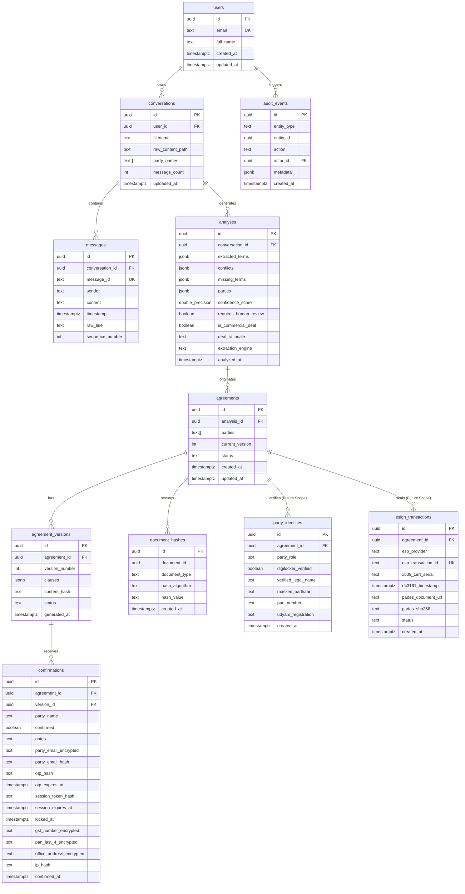

# DealShield AI — Database Design & Schema Architecture

## 1. Relational Entity Overview

The DealShield AI persistence layer is implemented on **PostgreSQL 15+** via Supabase, protected by Row Level Security (RLS) policies.

Migrations are maintained under `infra/supabase/migrations/`:
- `001_initial_schema.sql`: Core entities, triggers, RLS, and append-only audit log.
- `002_email_otp_verification.sql`: Zero-knowledge email verification, OTP rate limiting, and session tokens.
- `003_analysis_deal_gate.sql`: Commercial deal qualification gate and extraction engine transparency.
- `004_client_business_details.sql`: Client GST, business PAN last 4 digits, and office address.
- `005_encrypted_client_business_details.sql`: Application-level AES-256/Fernet encryption for business KYC data.



---

## 2. Table Specifications & Foreign Keys

### `users`
Extends Supabase `auth.users` with profile metadata.
- **PK:** `id` UUID references `auth.users(id)` ON DELETE CASCADE.
- **Fields:** `email` (UNIQUE), `full_name`, `created_at`, `updated_at`.
- **Auto-Provisioning:** Trigger `on_auth_user_created` on `auth.users` automatically inserts a corresponding row in `public.users` upon signup so initial uploads never fail foreign key checks.

### `conversations`
Represents an ingested WhatsApp chat file.
- **PK:** `id` UUID (`uuid_generate_v4()`).
- **FK:** `user_id` references `public.users(id)` ON DELETE CASCADE.
- **Fields:** `filename`, `raw_content_path` (Supabase Storage reference), `party_names` (`TEXT[]`), `message_count`, `uploaded_at`.

### `messages`
Individual parsed chat lines with deterministic citation IDs.
- **PK:** `id` UUID.
- **FK:** `conversation_id` references `public.conversations(id)` ON DELETE CASCADE.
- **Fields:** `message_id` (deterministic stable ID, e.g. `msg_raj_001`), `sender`, `content`, `timestamp`, `raw_line`, `sequence_number`.
- **Constraint:** `UNIQUE (conversation_id, message_id)` (scoped per conversation to avoid cross-chat collisions).

### `analyses`
Structured output from LLM analysis and deal qualification.
- **PK:** `id` UUID.
- **FK:** `conversation_id` references `public.conversations(id)` ON DELETE CASCADE.
- **Fields:** `extracted_terms` (`JSONB`), `conflicts` (`JSONB`), `missing_terms` (`JSONB`), `parties` (`JSONB`), `confidence_score` (`FLOAT`), `requires_human_review` (`BOOLEAN`).
- **Deal Gate Additions (Migration 003):**
  - `is_commercial_deal` (`BOOLEAN NOT NULL DEFAULT TRUE`): Whether conversation passes bilateral commercial qualification.
  - `deal_rationale` (`TEXT`): One-sentence rationale explaining commercial qualification status.
  - `extraction_engine` (`TEXT NOT NULL DEFAULT 'llm'`): Processing engine transparency (`llm` or `fallback`).

### `agreements`
Contract parent container.
- **PK:** `id` UUID.
- **FK:** `analysis_id` references `public.analyses(id)` ON DELETE CASCADE.
- **Fields:** `parties` (`TEXT[]`), `current_version` (INT), `status` (`draft`, `pending_confirmation`, `partially_confirmed`, `fully_confirmed`, `superseded`).

### `agreement_versions`
Immutable snapshot of contract clauses for each revision.
- **PK:** `id` UUID.
- **FK:** `agreement_id` references `public.agreements(id)` ON DELETE CASCADE.
- **Constraint:** `UNIQUE (agreement_id, version_number)`.
- **Fields:** `clauses` (`JSONB`), `content_hash` (TEXT, SHA-256 digest), `status`, `generated_at`.

### `confirmations`
Records party sign-off, objection notes, email-OTP authentication, and client business KYC.
- **PK:** `id` UUID.
- **FK:** `agreement_id` references `public.agreements(id)` ON DELETE CASCADE.
- **FK:** `version_id` references `public.agreement_versions(id)` ON DELETE CASCADE.
- **Constraint:** `UNIQUE (agreement_id, version_id, party_name)` (prevents duplicate entries per party per version).
- **Core Fields:** `party_name`, `confirmed` (BOOLEAN), `notes`, `confirmed_at`, `ip_hash` (secret-salted HMAC).
- **Email-OTP Security Columns (Migration 002):**
  - `party_email_encrypted`: Symmetric Fernet ciphertext of counterparty email.
  - `party_email_hash`: Blind-index HMAC-SHA256 for O(1) equality verification without decryption.
  - `otp_hash` & `otp_expires_at`: 6-digit cryptographic OTP hash with 10-minute validity.
  - `session_token_hash` & `session_expires_at`: 32-byte ephemeral review session token (`X-Review-Session`).
  - `locked_at`: Lockout timestamp after 5 failed attempts (HTTP 423).
- **Business KYC Columns (Migrations 004 & 005):**
  - `gst_number_encrypted`: Encrypted Goods & Services Tax identification.
  - `pan_last_4_encrypted`: Encrypted last 4 characters of Business PAN.
  - `office_address_encrypted`: Encrypted registered office address.

### `audit_events`
Append-only tamper-evident event log.
- **PK:** `id` UUID.
- **FK:** `actor_id` references `public.users(id)` ON DELETE SET NULL.
- **Fields:** `entity_type`, `entity_id`, `action`, `metadata` (`JSONB`), `created_at`.
- **Integrity Rule:** `INSERT` is restricted to service role only. Immutability enforced via trigger `enforce_audit_append_only` (blocks UPDATE/DELETE with an explicit exception allowing `actor_id ON DELETE SET NULL` for DPDP Act 2023 user erasure compliance).

### `document_hashes`
Cryptographic SHA-256 fingerprints.
- **PK:** `id` UUID.
- **Fields:** `document_id`, `document_type`, `hash_algorithm` (`sha256`), `hash_value` (64-char hex), `created_at`.
- **RLS Scope:** Scoped strictly to the entity owner.

---

## 3. Future Scope Database Extensions

For post-hackathon implementation of DigiLocker e-KYC and UIDAI Aadhaar eSign:

```sql
-- 1. Verified Legal Identity Ledger (DigiLocker Integration)
CREATE TABLE public.party_identities (
    id UUID PRIMARY KEY DEFAULT gen_random_uuid(),
    agreement_id UUID NOT NULL REFERENCES public.agreements(id) ON DELETE CASCADE,
    party_role VARCHAR(20) NOT NULL CHECK (party_role IN ('initiator', 'counterparty')),
    digilocker_verified BOOLEAN DEFAULT FALSE,
    verified_legal_name VARCHAR(255),
    masked_aadhaar VARCHAR(16), -- e.g. 'XXXXXXXX9842' (Zero raw Aadhaar storage)
    pan_number VARCHAR(10),
    udyam_registration VARCHAR(50),
    created_at TIMESTAMPTZ DEFAULT NOW()
);

-- 2. Statutory Digital Signature Records (CCA / ESP eSign Integration)
CREATE TABLE public.esign_transactions (
    id UUID PRIMARY KEY DEFAULT gen_random_uuid(),
    agreement_id UUID NOT NULL REFERENCES public.agreements(id) ON DELETE CASCADE,
    esp_provider VARCHAR(50) NOT NULL, -- 'cdac' | 'nsdl' | 'emudhra'
    esp_transaction_id VARCHAR(128) UNIQUE NOT NULL,
    x509_cert_serial VARCHAR(255) NOT NULL,
    rfc3161_timestamp TIMESTAMPTZ NOT NULL,
    pades_document_url TEXT NOT NULL,
    pades_sha256 VARCHAR(64) NOT NULL,
    status VARCHAR(30) DEFAULT 'completed',
    created_at TIMESTAMPTZ DEFAULT NOW()
);
```

---

## 4. Performance Indexes & Triggers

### Performance Indexes
- `idx_conversations_user_id` on `conversations(user_id)`
- `idx_messages_conversation_id` on `messages(conversation_id)`
- `idx_messages_message_id` on `messages(message_id)`
- `idx_analyses_conversation_id` on `analyses(conversation_id)`
- `idx_agreements_analysis_id` on `agreements(analysis_id)`
- `idx_agreement_versions_agreement_id` on `agreement_versions(agreement_id)`
- `idx_confirmations_agreement_id` on `confirmations(agreement_id)`
- `idx_confirmations_party_email_hash` on `confirmations(party_email_hash)`
- `idx_confirmations_session_token_hash` on `confirmations(session_token_hash)`
- `idx_confirmations_pan_last_4` on `confirmations(pan_last_4)`
- `idx_audit_events_entity` on `audit_events(entity_type, entity_id)`
- `idx_document_hashes_document` on `document_hashes(document_id, document_type)`
