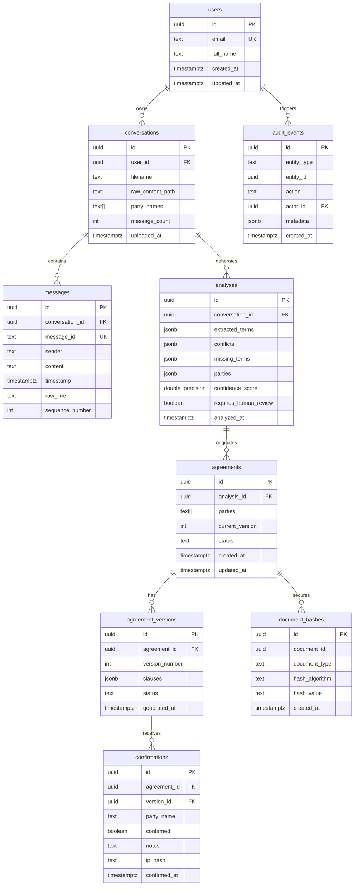

# DealShield AI — Database Design & Schema Architecture

## 1. Relational Entity Overview

The DealShield AI persistence layer is implemented on **PostgreSQL 15+** via Supabase, protected by Row Level Security (RLS) policies.

The core migration is located in [`infra/supabase/migrations/001_initial_schema.sql`](file:///C:/dealshield/infra/supabase/migrations/001_initial_schema.sql).

---

## 2. Table Specifications & Foreign Keys

### `users`
Extends Supabase `auth.users` with profile metadata.
- **PK:** `id` UUID references `auth.users(id)` ON DELETE CASCADE.
- **Fields:** `email` (UNIQUE), `full_name`, `created_at`, `updated_at`.

### `conversations`
Represents an ingested WhatsApp chat file.
- **PK:** `id` UUID (`uuid_generate_v4()`).
- **FK:** `user_id` references `public.users(id)` ON DELETE CASCADE.
- **Fields:** `filename`, `raw_content_path` (Supabase Storage reference), `party_names` (`TEXT[]`), `message_count`, `uploaded_at`.

### `messages`
Individual parsed chat lines with deterministic citation IDs.
- **PK:** `id` UUID.
- **FK:** `conversation_id` references `public.conversations(id)` ON DELETE CASCADE.
- **Fields:** `message_id` (deterministic stable ID, UNIQUE), `sender`, `content`, `timestamp`, `raw_line`, `sequence_number`.

### `analyses`
Structured output from LLM analysis.
- **PK:** `id` UUID.
- **FK:** `conversation_id` references `public.conversations(id)` ON DELETE CASCADE.
- **Fields:** `extracted_terms` (`JSONB`), `conflicts` (`JSONB`), `missing_terms` (`JSONB`), `parties` (`JSONB`), `confidence_score` (`FLOAT`), `requires_human_review` (`BOOLEAN`).

### `agreements`
Contract parent container.
- **PK:** `id` UUID.
- **FK:** `analysis_id` references `public.analyses(id)` ON DELETE CASCADE.
- **Fields:** `parties` (`TEXT[]`), `current_version` (INT), `status` (`draft`, `pending_confirmation`, `partially_confirmed`, `fully_confirmed`).

### `agreement_versions`
Immutable snapshot of contract clauses for each revision.
- **PK:** `id` UUID.
- **FK:** `agreement_id` references `public.agreements(id)` ON DELETE CASCADE.
- **Constraint:** `UNIQUE (agreement_id, version_number)`.
- **Fields:** `clauses` (`JSONB`), `status`, `generated_at`.

### `confirmations`
Records party sign-off and objection notes.
- **PK:** `id` UUID.
- **FK:** `agreement_id` references `public.agreements(id)` ON DELETE CASCADE.
- **FK:** `version_id` references `public.agreement_versions(id)` ON DELETE CASCADE.
- **Fields:** `party_name`, `confirmed` (BOOLEAN), `notes`, `ip_hash` (anonymized IP), `confirmed_at`.

### `audit_events`
Append-only tamper-evident event log.
- **PK:** `id` UUID.
- **FK:** `actor_id` references `public.users(id)` ON DELETE SET NULL.
- **Fields:** `entity_type`, `entity_id`, `action`, `metadata` (`JSONB`), `created_at`.
- **Integrity Rule:** `INSERT` is restricted to service role only.

### `document_hashes`
Cryptographic SHA-256 fingerprints.
- **PK:** `id` UUID.
- **Fields:** `document_id`, `document_type`, `hash_algorithm` (`sha256`), `hash_value` (64-char hex), `created_at`.

---

## 3. Database Triggers & Performance Indexes

### Auto-updating Timestamps
Tables with `updated_at` (`users`, `agreements`) trigger `public.update_updated_at()` before every update operation.

### Performance Indexes
- `idx_conversations_user_id` on `conversations(user_id)`
- `idx_messages_conversation_id` on `messages(conversation_id)`
- `idx_messages_message_id` on `messages(message_id)`
- `idx_analyses_conversation_id` on `analyses(conversation_id)`
- `idx_agreements_analysis_id` on `agreements(analysis_id)`
- `idx_agreement_versions_agreement_id` on `agreement_versions(agreement_id)`
- `idx_confirmations_agreement_id` on `confirmations(agreement_id)`
- `idx_audit_events_entity` on `audit_events(entity_type, entity_id)`
- `idx_document_hashes_document` on `document_hashes(document_id, document_type)`
