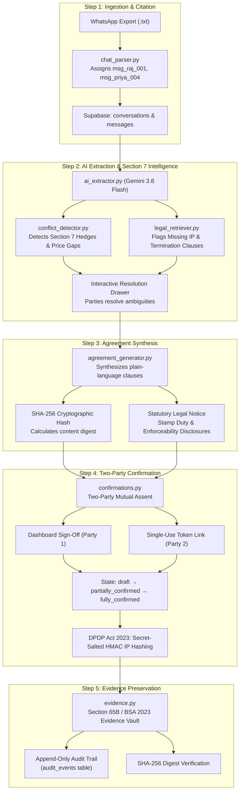

# DealShield AI — How It Works & System Workflow Guide

> **Hackathon Problem Statement LS-06: From Handshake to Contract**  
> *Transform informal WhatsApp business negotiations into structured, reviewable agreements with Section 7 conflict detection, two-party mutual confirmation, and tamper-evident audit records.*

---

## 1. Executive Summary: The Problem We Solve

In India and emerging markets, over **70% of MSMEs, freelancers, agencies, and independent contractors** conclude commercial transactions over **WhatsApp**. 

While fast and convenient, informal chat-based dealmaking creates severe legal and financial risks:

1. **The "Section 7" Legal Trap (Ambiguous Acceptance):**
   Under **Section 7 of the Indian Contract Act, 1872**, *"Acceptance must be absolute and unqualified"*. Informal statements like *"Sure, that works I think"*, *"depends on timeline"*, or *"let me think about it"* do **not** constitute legal acceptance. In litigation, Indian civil courts consistently treat conditional hedges as counter-proposals, meaning **no binding contract was ever formed**.

2. **The Default IP Trap (Copyright Act, 1957):**
   Under **Sections 17 & 19 of the Copyright Act, 1957**, the creator (freelancer/developer) is the first legal owner of copyright. Unless an explicit, written agreement irrevocably assigns intellectual property upon payment, the client **does not legally own** the software code, brand designs, or deliverables they paid for.

3. **The Evidentiary Admissibility Challenge (Section 65B):**
   Chat screenshots can be fabricated, cropped, or deleted. Under **Section 65B of the Indian Evidence Act, 1872** (now **Section 63 of the Bharatiya Sakshya Adhiniyam, 2023**), electronic evidence is inadmissible unless accompanied by mathematical proof of unbroken integrity and chain of custody.

4. **The Stamp Duty Warning (Indian Stamp Act, 1899):**
   Agreements in India require payment of applicable state stamp duty under Section 35 of the Indian Stamp Act, 1899 to be admissible in formal civil court enforcement proceedings.

**DealShield AI** bridges the gap between informal messaging and enforceable legal contracts through a 5-step automated LegalTech pipeline.

---

## 2. High-Level Workflow Diagram



---

## 3. Step-by-Step Workflow Walkthrough (With Real Example)

Let's trace the journey using the canonical sample fixture: **Raj Mehta** (Client / Startup Founder) and **Priya Sharma** (Service Provider / UI/UX Designer).

### Step 1: Upload & Chat Normalization (`/upload`)

**User Action:**
Raj exports his WhatsApp conversation with Priya as a `.txt` file (without media) and uploads it on the `/upload` page.

**Under the Hood:**
* Handled by `POST /api/v1/chats/upload` in [`chats.py`](file:///Users/tn/dealshield/apps/api/app/api/routes/chats.py).
* Scans the conversation to disambiguate date conventions, defaulting to Indian standard (`DD/MM/YYYY`).
* Normalizes multi-line messages and assigns **deterministic, stable citation IDs**:
  ```
  [msg_raj_001]   12/03/24, 10:15 - Raj Mehta: Hi Priya, regarding the website project we discussed
  [msg_priya_002] 12/03/24, 10:16 - Priya Sharma: Yes, I've been thinking about it. I can handle the full redesign
  [msg_raj_003]   12/03/24, 10:18 - Raj Mehta: Great. My budget is around ₹75,000 for everything
  [msg_priya_004] 12/03/24, 10:20 - Priya Sharma: That's quite low for a full redesign. I'd normally charge ₹1,50,000
  [msg_raj_005]   12/03/24, 10:22 - Raj Mehta: Can we meet somewhere in the middle? Maybe ₹1,00,000?
  [msg_priya_006] 12/03/24, 10:25 - Priya Sharma: I could consider that, but it depends on the timeline
  [msg_raj_007]   12/03/24, 10:27 - Raj Mehta: I need it done by end of April
  [msg_priya_008] 12/03/24, 10:30 - Priya Sharma: That's tight. For ₹1,00,000 I might be able to do it, but I'd need 50% upfront
  [msg_raj_009]   12/03/24, 10:32 - Raj Mehta: Sure, that works I think. Let's go ahead
  [msg_priya_010] 12/03/24, 10:35 - Priya Sharma: Ok sounds good. I'll send over some initial mockups next week
  ```
* Saves records in Supabase tables `conversations` and `messages`, returning a persistent `chat_id`.

---

### Step 2: AI Terms Extraction & Section 7 Conflict Resolution (`/analysis`)

**User Action:**
The user clicks **"Analyze Negotiation with DealShield AI"**. The frontend calls `POST /api/v1/analysis` and redirects to `/analysis?analysis_id=...&chat_id=...`.

**Under the Hood:**
* Executed by [`AIExtractorService`](file:///Users/tn/dealshield/apps/api/app/services/ai_extractor.py), [`ConflictDetectorService`](file:///Users/tn/dealshield/apps/api/app/services/conflict_detector.py), and [`LegalRetrieverService`](file:///Users/tn/dealshield/apps/api/app/services/legal_retriever.py).
* Extracts structured business terms conforming to Pydantic model [`AgreementAnalysis`](file:///Users/tn/dealshield/apps/api/app/schemas/analysis.py):
  1. **Scope (`term_scope_01`):** "Full website redesign with mockups" (`agreed`, cited: `msg_raj_001`, `msg_priya_002`, `msg_priya_010`).
  2. **Pricing (`term_price_01`):** Proposed ₹75,000 / ₹1,50,000, settled at ₹1,00,000 (`ambiguous`, cited: `msg_raj_003`, `msg_priya_004`, `msg_raj_005`, `msg_priya_008`, `msg_raj_009`).
  3. **Payment Terms (`term_payment_01`):** 50% upfront advance (₹50,000) (`agreed`, cited: `msg_priya_008`, `msg_raj_009`).
  4. **Timeline (`term_timeline_01`):** Delivery deadline by end of April 2024 (`agreed`, cited: `msg_raj_007`, `msg_priya_008`).

* **Section 7 Conflict Detection:**
  * Flags message `msg_raj_009`: *"Sure, that works I think. Let's go ahead"*.
  * **Statutory Context:** Section 7 of the Indian Contract Act, 1872 requires absolute and unqualified acceptance. The phrase *"that works I think"* is equivocal.
  * **Interactive Resolution Drawer:** Allows users to pick an explicit compromise resolution: *"Formally confirm consideration at ₹1,00,000 with ₹50,000 paid upon signing."* Resolving this changes the price term status from `ambiguous` to `agreed`.

* **Missing Safeguards Detection:**
  * **Intellectual Property (`missing_ip_01` - Critical):** Under Copyright Act 1957, Priya owns the copyright until assigned. Recommendation: *"Assign IP to Client upon full receipt of consideration."*
  * **Termination (`missing_termination_01` - Important):** Under Section 73 ICA, parties need cancellation rules. Recommendation: *"Add 7-day termination notice with payment for delivered work."*

* Saves findings in Supabase `analyses` and logs an immutable audit event in `audit_events`.

---

### Step 3: Plain-Language Agreement Synthesis (`/agreements`)

**User Action:**
The user clicks **"Synthesize Agreement Draft"**. The system calls `POST /api/v1/agreements` and navigates to `/agreements?id=...`.

**Under the Hood:**
* Handled by [`AgreementGeneratorService`](file:///Users/tn/dealshield/apps/api/app/services/agreement_generator.py) in [`agreements.py`](file:///Users/tn/dealshield/apps/api/app/api/routes/agreements.py).
* Converts informal chat points into structured, plain-language legal clauses:
  1. **Clause 1 (Scope):** Full website redesign services, preliminary mockups, responsive frontend layout, and final handover.
  2. **Clause 2 (Consideration & Payment):** Total fixed fee of ₹1,00,000 payable in two 50% (₹50,000) installments (upfront and upon final deliverable acceptance).
  3. **Clause 3 (Timeline):** Delivery deadline of April 30, 2024, with mockups within 7 business days of advance payment.
  4. **Clause 4 (Intellectual Property & Governing Law):** Irrevocable assignment of all copyright in designs and source code to Raj upon full payment receipt; governed by Indian law.
* **Interactive Citations:** Every clause displays clickable citation tags (`[msg_priya_008]`, `[msg_raj_009]`) that highlight the original chat messages in the side-by-side view.
* **SHA-256 Content Fingerprint:** Computes a SHA-256 digest of the agreement plaintext (e.g., `a591a6d4...`).
* **Stamp Duty Notice:** Prominently warns users that judicial enforcement in civil courts requires payment of state stamp duty under the Indian Stamp Act, 1899.
* **Document Export:** Plain-text and document exports available via `GET /api/v1/agreements/{id}/pdf`.

---

### Step 4: Two-Party Mutual Confirmation Workflow (`/confirmations`)

**User Action:**
The user proceeds to `/confirmations?agreement_id=...`.

**Under the Hood:**
* Handled by `POST /api/v1/confirmations` and `POST /api/v1/confirmations/token/{token}` in [`confirmations.py`](file:///Users/tn/dealshield/apps/api/app/api/routes/confirmations.py).
* **Party 1 (Raj Mehta):** Clicks **"Confirm Agreement as Raj Mehta"** in his dashboard.
  * Agreement status updates from `draft` → `partially_confirmed` (1 of 2 confirmed).
* **Party 2 (Priya Sharma):**
  * Counterparties without a DealShield account receive a **single-use signed token URL** (e.g. `/confirmations/token/{secure_token}`).
  * Priya opens the link, reviews the terms, adds optional notes, and confirms.
  * Agreement status transitions from `partially_confirmed` → `fully_confirmed` (2 of 2 confirmed).
* **DPDP Act 2023 Compliance:** Counterparty IP addresses are hashed using a secret-salted HMAC digest (`HashService.hash_ip`) before storage in the database to satisfy data minimization rules.

---

### Step 5: Section 65B Evidence Vault (`/evidence`)

**User Action:**
Once fully confirmed, the user navigates to `/evidence?entity_id=...`.

**Under the Hood:**
* Handled by `GET /api/v1/evidence/audit-log/{entity_id}` and `POST /api/v1/evidence/verify` in [`evidence.py`](file:///Users/tn/dealshield/apps/api/app/api/routes/evidence.py).
* Queries the append-only `audit_events` table in Supabase:
  ```json
  [
    { "action": "conversation_uploaded", "entity_type": "conversation", "created_at": "2024-03-12T10:35:00Z" },
    { "action": "analysis_completed", "entity_type": "analysis", "created_at": "2024-03-12T10:36:12Z" },
    { "action": "agreement_draft_generated", "entity_type": "agreement", "created_at": "2024-03-12T10:37:05Z" },
    { "action": "party_confirmation_recorded", "entity_type": "confirmation", "metadata": { "party": "Raj Mehta" } },
    { "action": "counterparty_token_confirmed", "entity_type": "confirmation", "metadata": { "party": "Priya Sharma" } }
  ]
  ```
* **Tamper Verification:** Users can input any agreement text and compare its live SHA-256 hash against the database fingerprint. If a single character was altered, verification fails immediately.
* **Legal Evidentiary Standing:** Provides mathematical integrity proof admissible under Section 65B of the Indian Evidence Act / Section 63 of Bharatiya Sakshya Adhiniyam, 2023.

---

## 4. API Endpoints & Database Entity Mapping

| Lifecycle Stage | HTTP Method & Route | Backend Service | Primary Database Table(s) |
|---|---|---|---|
| **1. Chat Ingestion** | `POST /api/v1/chats/upload` | `chat_parser.py` | `conversations`, `messages`, `document_hashes` |
| **2. Chat Retrieval** | `GET /api/v1/chats/{chat_id}` | `ConversationRepository` | `conversations`, `messages` |
| **3. Trigger Analysis** | `POST /api/v1/analysis` | `ai_extractor.py`, `conflict_detector.py` | `analyses`, `audit_events` |
| **4. Get Analysis** | `GET /api/v1/analysis/{analysis_id}` | `AnalysisRepository` | `analyses` |
| **5. Create Agreement** | `POST /api/v1/agreements` | `agreement_generator.py` | `agreements`, `agreement_versions`, `confirmations` |
| **6. Get Agreement** | `GET /api/v1/agreements/{agreement_id}` | `AgreementRepository` | `agreements`, `agreement_versions` |
| **7. Export Document** | `GET /api/v1/agreements/{id}/pdf` | `agreement_generator.py` | `agreements` (SHA-256 header) |
| **8. Submit Assent** | `POST /api/v1/confirmations` | `ConfirmationRepository` | `confirmations`, `agreements`, `audit_events` |
| **9. Token Assent** | `POST /api/v1/confirmations/token/{token}` | `ConfirmationRepository` | `confirmations`, `agreements`, `audit_events` |
| **10. Audit Trail** | `GET /api/v1/evidence/audit-log/{id}` | `AuditRepository` | `audit_events` |
| **11. Verify Hash** | `POST /api/v1/evidence/verify` | `hash_service.py` | In-memory SHA-256 computation |

---

## 5. How to Run & Verify the Live Flow

### 1. Start Backend API
```bash
cd apps/api
source .venv/bin/activate    # Or .\.venv\Scripts\Activate.ps1 on Windows
python -m pytest tests/ -v  # Run 34 unit & integration tests
uvicorn app.main:app --reload --port 8000
```

### 2. Start Frontend Application
```bash
# In another terminal from repository root or apps/web:
npm run dev
```

### 3. Experience the Live Walkthrough
1. Open [http://localhost:3000/upload](http://localhost:3000/upload).
2. Click **"Load Sample Negotiation (Raj vs Priya)"** and click **"Parse Pasted Transcript"**.
3. Click **"Analyze Negotiation with DealShield AI"**.
4. On `/analysis`, inspect the detected Section 7 conflict on `msg_raj_009` and resolve it in the drawer.
5. Click **"Synthesize Agreement Draft"**.
6. On `/agreements`, review the 4 synthesized clauses with citation tags and the SHA-256 fingerprint.
7. Click **"Proceed to Two-Party Confirmation"**.
8. On `/confirmations`, click **"Confirm Agreement as Raj Mehta"** and **"Confirm Agreement as Priya Sharma"**.
9. Once fully confirmed, click **"Inspect Section 65B Evidence Vault"** to query the live immutable audit trail.
